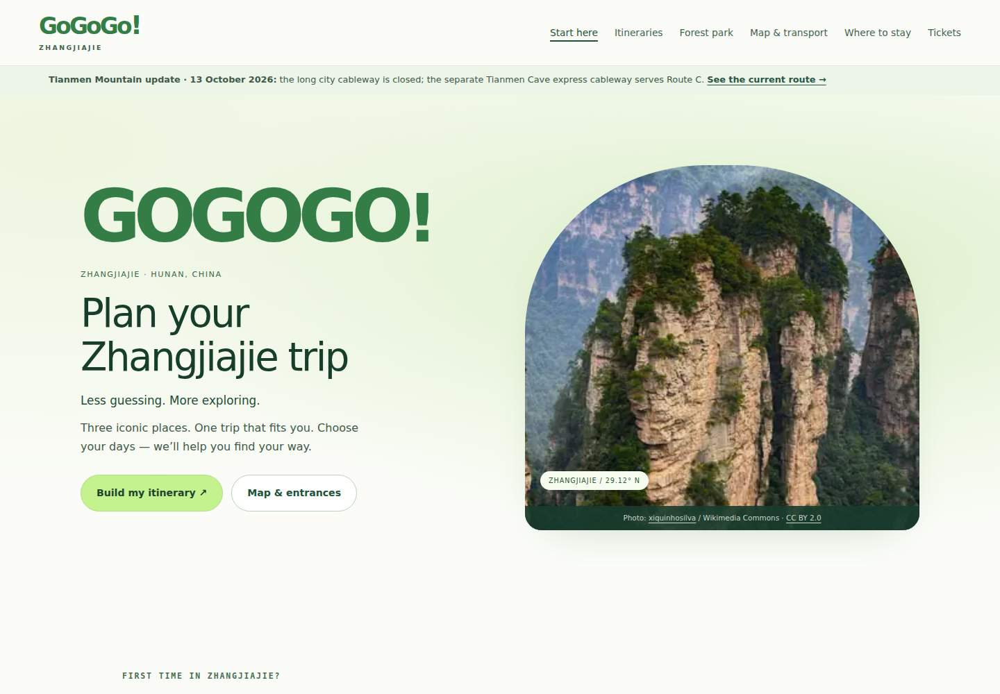
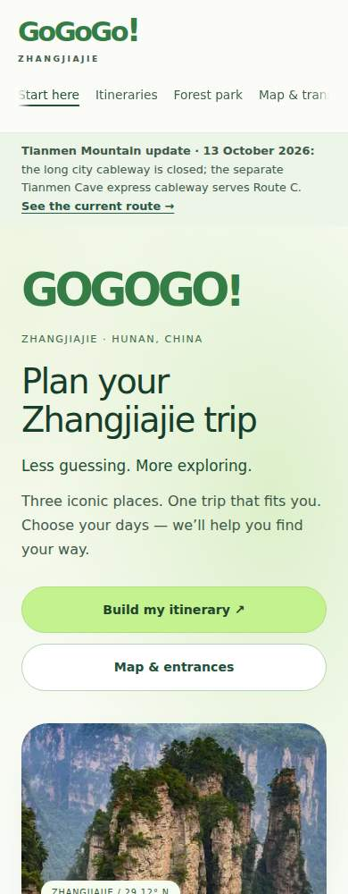

# Airy GoGoGo homepage — 30 October 2026

Scope: homepage presentation only, following Chunyang Rongxue. Audience: independent English-speaking visitors choosing sights and a 2–4 day route. No planner logic or guide content changed.

## Observation → adaptation

| Evidence | Mechanism | Adaptation | Trade-off |
| --- | --- | --- | --- |
| https://lite.ego.app/ja, directly viewed 30 October: diffuse blue hero, generous negative space, compact central call to action, rounded controls | Reduce competing visual anchors | Pale green landscape light, two hero actions, strong green GOGOGO wordmark | Travel needs real scenery and route notices, so retain both rather than copying the product landing screen |
| Existing homepage: dark navigation, serif headings, square editorial panels, four hero actions | Good photography and guide hierarchy, but visually weighty | Light navigation, sans-serif headings, rounded landscape frame, quieter cards | Intentionally limited to homepage; itinerary and guide pages keep their existing style |
| Existing planner: real selectable routes, URL restoration, static fallback, image attribution | Useful functionality already present | Retain controls and content; soften surfaces and buttons | No claimed improvement in conversion or task time without visitor measurements |

Motion uses short entrance transitions and hover feedback. No animation framework, continuous looping, scroll hijacking, or initially hidden script-dependent content. Reduced-motion users get no entrance animation.

## Checks

- Baseline and changed build: 12 pages pass static checks, links, anchors, image references, alt text, JSON-LD, sitemap and asset fingerprints.
- JavaScript syntax: passes; no JavaScript changed.
- Planner DOM checks: 36 cases pass, including URL changes and invalid query fallback.
- Browser and visual checks: results recorded below after execution.

Release: branch/PR for review, not production deployment. Rollback: revert this change; styles are scoped to `.home-page` and planner data is untouched.

Browser results: Chromium 153 (npm-packaged binary, after the Playwright CDN downloads failed) passes all 12 pages at 390/768/1024px, image loading, 36 planner combinations, mobile/map targets, URL restoration, clipboard fallback/focus, map lookup, 320px enlarged-text reflow, print content and no-JS fallback. Desktop 1440px and mobile 390px screenshots inspected. Mobile hero now puts the task and green wordmark before photography. Entrance motion respects reduced-motion preferences; visual aesthetics remain pending user review.

